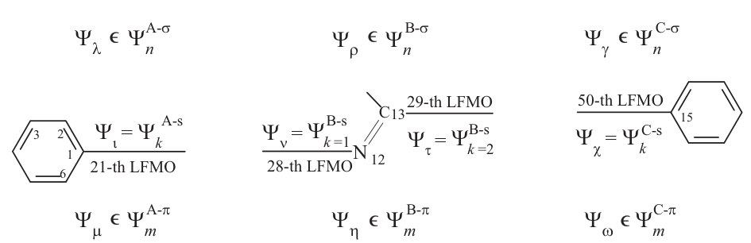
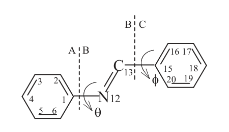
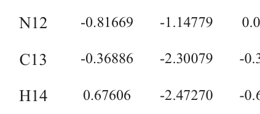

# 原子编号说明

五个基组采用同一独立重建NBA几何、原子顺序和正式映射。

原著图3-1、表3-2及图5-11／§5.4.1给出的四个切口种子为C1、N12、C13、C15，两切口为C1–N12及C13–C15。需求中的C14经用户确认，是原著C15这个同一接键碳的别名；原著H14另按氢原子登记。

| 项目零基索引 | 元素 | 片段 | 原著关键标签 | 需求别名 |
|---|---|---|---|---|
| 0 | C | A | C1 | C1 |
| 6 | N | B | N12 | N12 |
| 7 | C | B | C13 | C13 |
| 8 | C | C | C15 | C14 |
| 19 | H | B | H14 | H14 |

[原子映射原始数据（JSON）](../inputs/nba-planar/atom-label-mapping.json)记录25个项目原子的元素、片段、保存坐标及连接。关键标签来自原著核对；其余原子以项目索引和拓扑关系识别，外围H的历史数字字段按来源留空。几何来源与原著标签来源分别登记。

原著编号局部图示：

原著图表权利按原来源保留。
